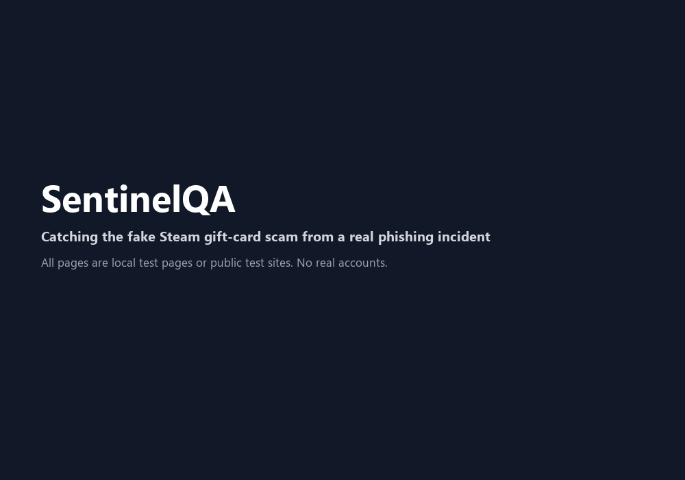

# SentinelQA + TrustGuard

A layered anti-phishing toolkit built from a real account-takeover incident:

- **SentinelQA** — a Chrome (MV3) extension that audits the page you are on and grades it A–F.
- **netguard** — a small command-line check for the public-Wi-Fi stage: router swapped (evil
  twin), DNS redirected, certificates rejected.
- **TrustGuard** — a chat bot (Discord and Slack adapters on one shared engine) that detects
  messages sent from *compromised but trusted* accounts and re-verifies people who rejoin.



It started with a QA engineer's question — "we test functionality all day, who tests security?" —
and grew after a phishing incident showed why URL checking alone is not enough.

## Incident-driven design

A colleague's chat account was hijacked, most likely through a session or credential theft on
public Wi-Fi days earlier. The attacker messaged everyone on the account's friend list with a
short, greeting-less "$50 Steam gift" link to a look-alike Steam domain. Because the sender was a
known colleague, several people clicked and entered their credentials on the fake page, and the
compromise spread to their email and other accounts that reused the password. One recipient
openly questioned the message but trust still won. After the account was removed from the work
server, the attacker came back with a *new* account and was let in, because nothing asked who
they were.

Traditional filters fail here because the sender was legitimate. Detection has to be behavioural
and contextual, at every stage of the chain:

| Attack stage | What happened | What catches it | Where |
|---|---|---|---|
| Network | Credentials/session stolen on open Wi-Fi | Certificate/TLS error capture; DNS-over-HTTPS cross-check of the server IP; router hardware-address change on a known network | Extension (`background.js`, `lib/netchecks.js`) + netguard |
| Spread | Hijacked account mass-messages a lure | Message scoring (money lure + external link + no greeting + brand look-alike + masked link), same-message burst detection, multi-reporter escalation | TrustGuard core |
| Lure link | `steamcommunnity.com/gift-card/pay/50`-style URL | Brand look-alike / brand-in-domain detection, lure words, new-domain age (RDAP), optional Safe Browsing | Extension (`lib/core.js`) + TrustGuard |
| Credential harvest | Fake Steam sign-in page | Password form whose title/heading claims a brand the domain does not own | Extension (`content.js`) |
| Re-infiltration | Attacker rejoins with a new account | Re-verification: held joins for removed IDs, look-alike names, very new accounts, post-compromise lockdown | TrustGuard core + adapters |

## Repository layout

```
manifest.json, background.js, content.js, popup.*, options.*   Chrome extension
lib/core.js         pure detection + scoring logic (shared by popup, content script, service worker, tests)
lib/netchecks.js    online lookups (RDAP, DoH, Safe Browsing) - popup only
lib/rules.js        GENERATED brand/TLD/look-alike data (from shared/rules.json)
shared/rules.json   the one rule set used by the extension and the bot (npm run build:rules)
tests/              Node unit tests for lib/core.js + rule-copy parity
netguard/           Python CLI: passive public-Wi-Fi interception checks + tests
trustguard/         Python package: platform-neutral engine + Discord/Slack adapters + tests
docs/case-study.md  technical write-up (PDF: docs/case-study.pdf, rebuilt by scripts/build-writeup-pdf.py)
docs/rollout-guide.md  office rollout: what is checked, what data is (not) collected, admin runbook
docs/demo.md        how to record the demo GIF
CHANGELOG.md        release notes, each feature tied to an incident stage
```

## SentinelQA extension

**URL level** — HTTPS, raw-IP host, `@` trick, punycode, abused TLDs, digits in domain, pressure
keywords, URL length, **brand look-alike domains** (`paypa1.com`, `steamcommunnity.com`),
**brand names in unrelated domains** (`steam-gift.xyz`), **brand + reward-lure combination**.

**Page level** — password field submitting over HTTP, mixed content, **fake login page**
(password form presenting itself as a brand the domain does not belong to).

**Transport** — missing security headers (X-Frame-Options, CSP, X-Content-Type-Options, HSTS),
**certificate/TLS errors** (`ERR_CERT_*`, `ERR_SSL_*` — kept on the report even if you click
through the warning), **redirect chains** across several domains.

**Online checks** (run only from the popup, only for the site you scan; can be turned off in
Settings) — domain registration age via rdap.org, server IP cross-checked against Cloudflare
DNS-over-HTTPS, and Google Safe Browsing if you add your own API key.

Privacy note: each online check sends the scanned hostname (Safe Browsing: the full URL) to that
provider. Nothing is sent on ordinary browsing. The DoH check is a weak signal: CDNs and geo-DNS
legitimately return different IPs, so it only adds 10 points.

What it cannot see: the extension observes HTTP(S) requests and page content only. It has no
packet-level visibility and does not detect ARP spoofing or rogue access points directly; it
detects their usual *symptoms* (certificate errors, DNS mismatches).

### Install (developer mode)
1. Open `chrome://extensions`, turn on **Developer mode**
2. **Load unpacked** and select this folder
3. Click the SentinelQA icon on any website

### Try it
- `google.com` → A
- `neverssl.com` → B/C (no HTTPS, missing headers)
- `localhost:8000/test.html` → password-over-HTTP warning
- `test-fake-login.html` served from a non-localhost name → fake Steam login warning
- `https://expired.badssl.com` / `https://self-signed.badssl.com` → certificate error, grade F

### Tests
```bash
npm test
```

After editing brands, TLDs or look-alike pairs in `shared/rules.json`:
```bash
npm run build:rules
```

## TrustGuard bot

See [trustguard/README.md](trustguard/README.md); to try it live in a test workspace,
[docs/pilot-guide.md](docs/pilot-guide.md); for deploying it to a team,
[docs/rollout-guide.md](docs/rollout-guide.md). One engine, thin adapters:

| Platform | Status | What the bot can see |
|---|---|---|
| Discord | Adapter implemented | Server channels it can read (Message Content intent) and DMs sent **to the bot**. Bots **cannot** read private user-to-user DMs, so DM phishing is handled by users forwarding suspicious DMs to the bot; independent reports against one sender escalate to moderators. |
| Slack | Adapter implemented; **the office deployment** | Channels it is invited to and DMs to the bot. Colleagues report private DMs with *Share message*. Moderator commands, edit re-scoring, deactivation tracking and channel-join re-verification (including Slack Connect guests). Bot tokens cannot delete other users' messages, so "quarantine" is a threaded warning plus a moderator alert for an admin to act on. One-step install from [`slack-app-manifest.yml`](trustguard/slack-app-manifest.yml). |
| Teams | Future work | Bot Framework; enterprise angle. |
| Telegram | Out of scope | Bots only see messages sent to them or in groups they're in. |
| WhatsApp | Out of scope | Closed Business API. |

The extension is the platform-agnostic layer (it protects links from any chat app opened in the
browser); the bot adapters protect where they are invited.

## Known limitations and future work

Every check here is an explainable heuristic: each grade or verdict lists the signals and points
behind it. That makes the tools auditable and easy to tune, and it also defines where they stop.

| Area | Current limitation | Future direction |
|---|---|---|
| Risk scoring | Fixed point weights; no handling of evasion, class imbalance or false-positive tuning; precision/recall on real traffic unmeasured | ML-based scoring with evasion testing, evaluated on labelled data |
| Bot anomaly detection | Keyword and rate rules; an attacker who knows them can write around them (add a greeting, avoid lure words) | Statistical, per-sender baselines; a formal threat model |
| Token theft on public Wi-Fi | Extension and netguard detect symptoms (certificate errors, DNS redirection, router change), not the theft itself | Deeper protocol-level analysis of session handling |
| Fake login detection | Brand list + password-form heuristics | Auth-flow analysis (OAuth/SAML failure modes) |
| Re-verification | Admin approval after an out-of-band check; practical, not formally designed | Formal access control / zero-trust identity assurance |
| User behaviour | People click despite doubt (one recipient in the incident asked "what is this?" and the chain still spread) | Warning UX design and evaluation |
| Platform reach | Bots cannot read private user-to-user DMs on Discord or Slack; DM phishing relies on users reporting | Teams adapter; client-side (extension) coverage of chat web apps |

## Roadmap
- [x] Page-level checks: insecure forms, mixed content
- [x] Security headers
- [x] Shared detection core + unit tests + CI
- [x] One rule set for every layer (`shared/rules.json`), stale copies fail CI
- [x] Network companion ([netguard](netguard/README.md)): router change, DNS redirection, certificate errors
- [x] Brand impersonation and fake-login detection
- [x] TLS error capture, redirect chains, domain age, DoH cross-check, Safe Browsing
- [x] TrustGuard engine, Discord and Slack adapters
- [x] Technical write-up ([Markdown](docs/case-study.md) / [PDF](docs/case-study.pdf)) and release notes
- [x] Persist TrustGuard re-verification state (SQLite, no message content) across restarts
- [x] Office rollout guide ([docs/rollout-guide.md](docs/rollout-guide.md))
- [x] Demo GIF ([docs/demo.gif](docs/demo.gif))
- [ ] Optional Python language tool (message-language analysis for non-English lures)
- [ ] Teams adapter
- [ ] ML-based scoring with evasion robustness (current scoring is explainable heuristics)

## License
MIT
